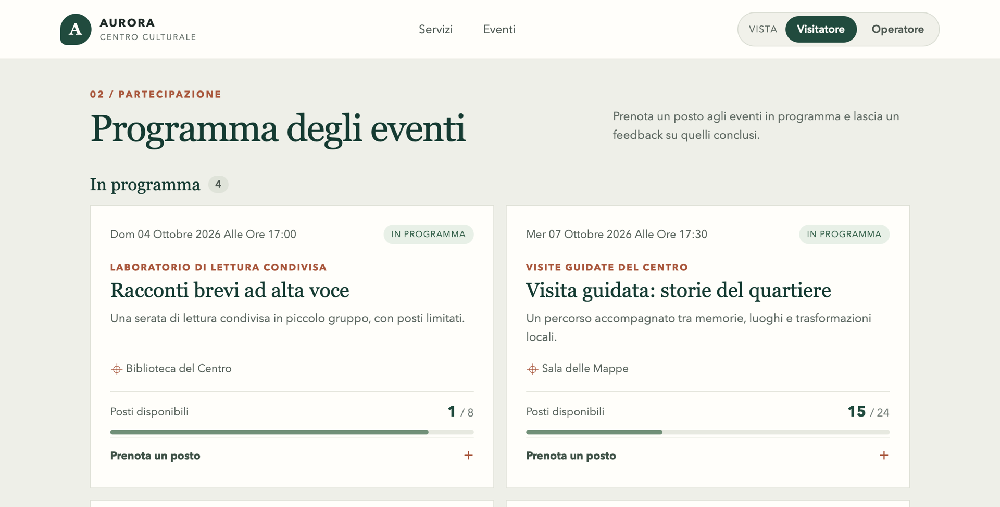
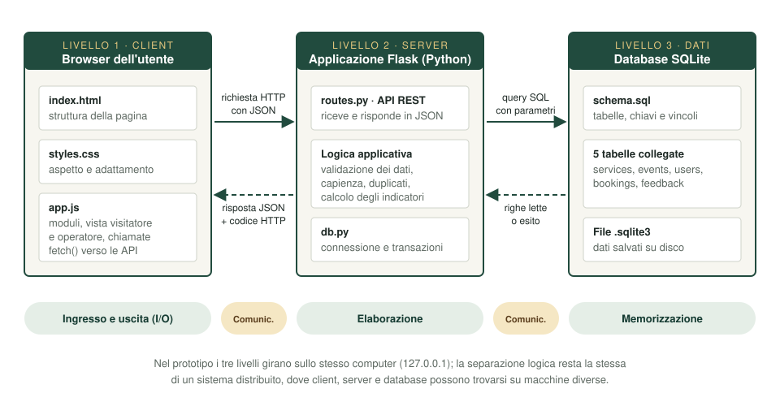

# Centro Culturale Aurora

Prototipo di piattaforma web per la gestione di servizi, eventi, prenotazioni e feedback di un'impresa culturale. Digitalizza un processo completo: **catalogo dei servizi → programma degli eventi → prenotazioni → feedback → indicatori**.

Project Work per il Corso di Studio in Informatica per le Aziende Digitali (L-31) dell'Università Telematica Pegaso — Tema 1, *La digitalizzazione dell'impresa*, Traccia 22: *«Digitalizzazione dei processi aziendali in un'impresa culturale: progettazione di una piattaforma informatica per la gestione di servizi, dati e utenti»*.

Il Centro Culturale Aurora è un'organizzazione simulata: nomi, eventi e dati sono di fantasia.



## Che cosa fa

Il prototipo ha due viste, selezionabili in alto a destra nella pagina.

**Vista Visitatore**, per il pubblico:

- consulta il catalogo dei servizi attivi e il programma degli eventi;
- prenota da 1 a 20 posti indicando nome ed email;
- dopo l'evento lascia una valutazione da 1 a 5 con un commento e legge i feedback ricevuti.

**Vista Operatore**, per il personale del Centro:

- aggiunge, modifica, sospende e rimuove i servizi del catalogo;
- pubblica, modifica e rimuove gli eventi;
- consulta i partecipanti di ogni evento e annulla una prenotazione;
- consulta l'anagrafica dei partecipanti;
- legge gli indicatori: prenotazioni, posti, valutazione media, occupazione degli eventi futuri.

Le due viste sono dimostrative: il prototipo non ha account né password.

## Architettura

Il sistema è diviso in tre livelli che comunicano tramite API REST.



| Livello | Tecnologia | File |
|---|---|---|
| Presentazione | HTML5, CSS3, JavaScript senza framework | `app/static/` |
| Applicativo | Python con Flask, API REST in JSON | `app/routes.py`, `app/db.py` |
| Dati | SQLite, database relazionale su file | `app/schema.sql` |

Processo, casi d'uso, modello dei dati e flusso di una prenotazione sono descritti in [docs/architettura.md](docs/architettura.md).

## Avvio

Requisiti: Python 3.9 o successivo e, al primo avvio, una connessione a Internet per installare Flask, che è l'unica dipendenza. Il database viene creato da solo.

### Con un doppio clic

1. Doppio clic su `Avvia Aurora (Mac).command`, oppure su `Avvia Aurora (Windows).bat`.
2. Si apre una finestra di testo, che va lasciata aperta finché si usa il prototipo.
3. Il browser si apre da solo su `http://127.0.0.1:5050`.
4. Per fermare il prototipo si chiude la finestra di testo.

L'avvio è stato verificato su macOS. Il file per Windows è stato predisposto ma non ancora provato su quel sistema.

### Da terminale

```bash
python3 -m venv .venv
source .venv/bin/activate          # Windows: .venv\Scripts\activate
python -m pip install -r requirements.txt
python avvia.py
```

Opzioni di `avvia.py`:

| Opzione | Effetto |
|---|---|
| `--reset-demo` | Cancella i dati e ricarica quelli dimostrativi, con le date ricalcolate su oggi |
| `--port 5080` | Usa un'altra porta; se è occupata viene scelta la prima libera successiva |
| `--no-browser` | Non apre il browser |

## Dati dimostrativi

Al primo avvio vengono caricati 5 servizi, 6 eventi (4 futuri e 2 conclusi), 6 partecipanti, 15 prenotazioni e 5 feedback, tutti con nomi di fantasia.

Le date degli eventi sono calcolate rispetto al giorno di caricamento. Dopo circa due settimane gli eventi risultano tutti conclusi: il file `Ripristina dati demo`, o l'opzione `--reset-demo`, ricarica i dati con le date aggiornate.

## Test

```bash
python -m unittest discover -s tests -v
```

I 13 test simulano le richieste alle API su un database temporaneo e non toccano i dati dimostrativi. Risultati e scenari d'uso sono in [docs/test_funzionali.md](docs/test_funzionali.md).

## API

Le API scambiano dati in formato JSON e sono organizzate per risorsa. La specifica completa, con campi, vincoli ed esempi, è in [docs/api.md](docs/api.md).

| Risorsa | Percorso | Operazioni |
|---|---|---|
| Servizi | `/api/services`, `/api/services/<id>` | Elenco, dettaglio, creazione, modifica, eliminazione |
| Eventi | `/api/events`, `/api/events/<id>` | Elenco, dettaglio, creazione, modifica, eliminazione |
| Prenotazioni | `/api/events/<id>/bookings`, `/api/bookings/<id>` | Elenco per evento, creazione, annullamento |
| Feedback | `/api/events/<id>/feedback` | Elenco per evento, creazione |
| Partecipanti | `/api/users` | Anagrafica con conteggi |
| Indicatori | `/api/dashboard` | Dati aggregati |
| Stato | `/api/health` | Verifica che il servizio risponda |

## Struttura del repository

```text
Avvia Aurora (Mac).command        Avvio con doppio clic su macOS
Avvia Aurora (Windows).bat        Avvio con doppio clic su Windows
Ripristina dati demo (...)        Ricarica i dati dimostrativi
avvia.py                          Script di avvio: sceglie la porta e apre il browser
requirements.txt                  Dipendenze Python
app/
  __init__.py                     Configurazione dell'applicazione Flask
  routes.py                       API REST, validazioni e regole applicative
  db.py                           Connessione SQLite, dati dimostrativi, ripristino
  schema.sql                      Tabelle, relazioni, vincoli e indici
  static/
    index.html                    Struttura dell'interfaccia
    styles.css                    Aspetto grafico e adattamento agli schermi
    app.js                        Interazione e chiamate alle API
tests/
  test_api.py                     Test funzionali automatici
docs/
  architettura.md                 Processo, casi d'uso, architettura, modello dei dati
  api.md                          Specifica delle API
  test_funzionali.md              Test automatici e scenari d'uso
  diagrammi/                      Diagrammi in formato SVG
  screenshot/                     Schermate del prototipo
```

Il database viene creato al primo avvio in `instance/centro_culturale_aurora.sqlite3` e non fa parte del repository.

## Problemi comuni

| Che cosa succede | Che cosa fare |
|---|---|
| Su macOS: «non può essere aperto perché proviene da uno sviluppatore non identificato» | Clic destro sul file, **Apri**, poi di nuovo **Apri**. Succede una sola volta |
| Su macOS: doppio clic senza effetto, oppure «permesso negato» | Nel Terminale scrivere `chmod +x ` seguito da uno spazio, trascinare il file `.command` nella finestra e premere Invio |
| Su Windows: «Python 3 non è installato» | Installare Python da <https://www.python.org/downloads/> selezionando **Add python.exe to PATH** |
| L'indirizzo finisce con 5051 anziché 5050 | È normale: la porta 5050 era occupata ed è stata scelta la successiva |
| La pagina mostra la fascia rossa «Il prototipo è spento» | La finestra di testo è stata chiusa: riavviare il prototipo, la pagina si riattiva da sola |
| Tutti gli eventi risultano conclusi | Usare `Ripristina dati demo` |

La porta abituale di Flask, la 5000, sui Mac recenti è occupata da un servizio di sistema: per questo il prototipo parte dalla 5050.

## Limiti

È un prototipo locale e dimostrativo.

- Non c'è autenticazione: le viste visitatore e operatore non sono protette, e chi raggiunge il prototipo può modificare i dati e leggere nomi ed email dei partecipanti.
- Usa il server di sviluppo di Flask e non è adatto alla pubblicazione in rete.
- La persona è identificata dalla sola email, che non viene verificata.
- Il feedback non è vincolato alla partecipazione effettiva.
- Non invia conferme né promemoria via email.
- SQLite ammette una sola scrittura alla volta: adeguato a un prototipo, non a molti utenti contemporanei.

Possibili sviluppi: autenticazione e ruoli, pubblicazione su un servizio cloud con un database server, pagamenti, statistiche nel tempo, lista d'attesa per gli eventi esauriti.
