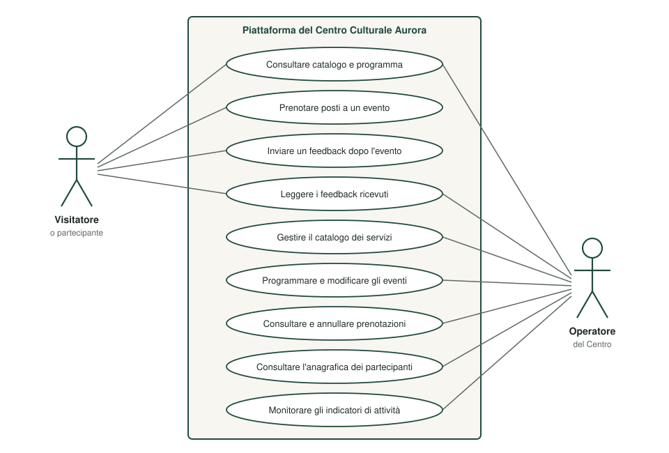
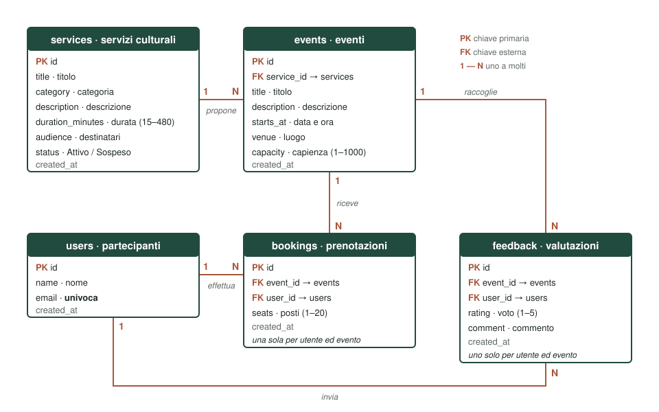
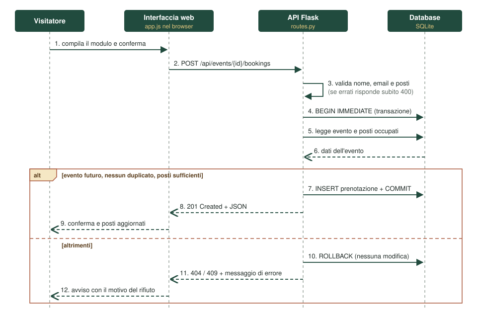

# Architettura del prototipo

Questo documento descrive il processo che il prototipo digitalizza, i casi d'uso, l'architettura applicativa, il modello dei dati e il flusso di una prenotazione.

## Il processo digitalizzato

Il Centro Culturale Aurora è un'organizzazione simulata: un centro di quartiere che propone visite guidate, laboratori di lettura, incontri pubblici e attività per famiglie, in spazi a capienza limitata. Il prototipo sostituisce strumenti separati — elenchi, fogli di calcolo, email, moduli cartacei — con un unico sistema in cui ogni dato è inserito una sola volta e resta collegato agli altri.

Il processo si compone di sette passi:

1. l'operatore registra nel catalogo un servizio culturale, con categoria, descrizione, durata, destinatari e stato;
2. l'operatore programma un evento collegandolo a un servizio attivo e indicando data, ora, luogo e capienza;
3. il visitatore consulta il programma e, per l'evento scelto, invia nome, email e numero di posti;
4. il sistema verifica i dati, la data dell'evento, l'assenza di una prenotazione precedente della stessa persona e la disponibilità dei posti, quindi registra la prenotazione;
5. l'operatore consulta l'elenco dei partecipanti e, se necessario, annulla una prenotazione;
6. dopo l'evento il partecipante invia una valutazione da 1 a 5 e un commento;
7. il sistema aggrega i dati in indicatori consultabili dall'operatore.

### Regole applicate dal sistema

| Regola | Motivo |
|---|---|
| Un evento appartiene sempre a un servizio del catalogo | Il programma resta coerente con l'offerta |
| Non si programmano eventi per un servizio sospeso | Un servizio in pausa non riceve nuove date |
| Le prenotazioni non superano la capienza | Non si promettono posti che non esistono |
| Una persona prenota una sola volta per evento | Si evitano i doppioni; la persona è riconosciuta dall'email |
| Non si prenota un evento già iniziato | La prenotazione ha senso solo prima |
| Il feedback si invia solo dopo l'evento, una volta sola | Si valuta ciò che è avvenuto |
| La capienza non scende sotto i posti già prenotati | Non si tolgono posti a chi ha prenotato |
| Non si elimina un servizio con eventi, né un evento con prenotazioni o feedback | Non si perdono dati collegati |

Ogni regola è controllata dal back-end e non soltanto dalla pagina: chi chiamasse direttamente le API troverebbe gli stessi controlli.

## Casi d'uso

Gli attori sono due. Il **visitatore** rappresenta il pubblico, l'**operatore** il personale del Centro. Nell'interfaccia corrispondono a due viste selezionabili, che cambiano gli strumenti mostrati. La distinzione è dimostrativa: non esiste un controllo di accesso.

| ID | Requisito funzionale | Attore |
|---|---|---|
| RF1 | Consultare il catalogo dei servizi e il programma degli eventi | Visitatore, operatore |
| RF2 | Prenotare da 1 a 20 posti indicando nome ed email | Visitatore |
| RF3 | Impedire prenotazioni oltre la capienza, duplicate o per eventi già iniziati | Sistema |
| RF4 | Inviare una valutazione da 1 a 5 con commento, solo dopo l'evento e una sola volta | Visitatore |
| RF5 | Leggere i feedback di un evento | Visitatore, operatore |
| RF6 | Creare, modificare, sospendere ed eliminare i servizi | Operatore |
| RF7 | Creare, modificare ed eliminare gli eventi | Operatore |
| RF8 | Consultare i partecipanti di un evento e annullare una prenotazione | Operatore |
| RF9 | Consultare l'anagrafica dei partecipanti | Operatore |
| RF10 | Consultare gli indicatori di attività | Operatore |

## Architettura a tre livelli

- **Livello di presentazione.** Il browser riceve una pagina HTML, un foglio di stile e uno script JavaScript. Lo script non contiene dati: li richiede alle API con `fetch()` e aggiorna la pagina senza ricaricarla.
- **Livello applicativo.** Un'applicazione Python basata su Flask espone le API REST. Ogni rotta valida i dati in ingresso, applica le regole del processo, interroga il database e restituisce una risposta JSON con un codice HTTP coerente.
- **Livello dei dati.** Un database relazionale SQLite conserva cinque tabelle collegate da chiavi esterne.

Ogni livello può essere modificato o sostituito senza toccare gli altri, purché resti invariata l'interfaccia che li collega.

### Elaborazione, memorizzazione, comunicazione

**Elaborazione.** Il back-end è un processo in esecuzione: il processore esegue le istruzioni dell'interprete Python, che operano su dati tenuti in memoria centrale. L'elaborazione consiste in validazione dei campi, confronto tra date, somma dei posti prenotati, verifica della capienza, calcolo di medie e percentuali. Una parte è delegata al motore del database, con funzioni di aggregazione come `SUM`, `AVG` e `COUNT`. Anche il client elabora: il browser esegue lo script che costruisce la pagina a partire dai dati ricevuti.

**Memorizzazione.** Durante una richiesta i dati risiedono nella memoria centrale del processo, veloce ma volatile. Per renderli persistenti vengono scritti in un file su memoria di massa, `instance/centro_culturale_aurora.sqlite3`. Il passaggio è governato dalle transazioni: fino al `COMMIT` le modifiche non sono definitive, e un `ROLLBACK` riporta il database allo stato precedente. Tre indici, sulla data degli eventi e sul riferimento all'evento in prenotazioni e feedback, riducono gli accessi al disco nelle ricerche più frequenti.

**Comunicazione.** Client e server sono processi separati che comunicano con il protocollo HTTP, trasportato da TCP/IP. Nel prototipo entrambi girano sulla stessa macchina e usano l'interfaccia di loopback, all'indirizzo `127.0.0.1` e alla porta 5050, ma lo scambio avviene come tra due computer distinti: il client invia una richiesta composta da metodo, percorso, intestazioni e corpo, e riceve una risposta composta da codice di stato, intestazioni e corpo. I dati strutturati sono serializzati in JSON. Tra back-end e database la comunicazione avviene per chiamate di libreria, con comandi SQL.

**Concorrenza.** Più richieste possono arrivare nello stesso momento. Il caso critico è la prenotazione dell'ultimo posto: due richieste che leggessero insieme «un posto libero» lo assegnerebbero entrambe. Il prototipo esegue lettura dei posti e inserimento dentro una transazione aperta con `BEGIN IMMEDIATE`, che acquisisce subito il blocco in scrittura sul database: la seconda richiesta attende la conclusione della prima e trova il posto già occupato.

## Modello dei dati

| Tabella | Contenuto | Relazioni |
|---|---|---|
| `services` | Servizi culturali: titolo, categoria, descrizione, durata, destinatari, stato | Un servizio ha molti eventi |
| `events` | Eventi: servizio, titolo, descrizione, data e ora, luogo, capienza | Un evento ha molte prenotazioni e molti feedback |
| `users` | Partecipanti: nome, email univoca | Un partecipante ha molte prenotazioni e molti feedback |
| `bookings` | Prenotazioni: evento, partecipante, posti | Collega partecipanti ed eventi |
| `feedback` | Valutazioni: evento, partecipante, voto, commento | Collega partecipanti ed eventi |

`bookings` e `feedback` realizzano due relazioni molti-a-molti tra partecipanti ed eventi, ciascuna con attributi propri.

Due scelte progettuali:

- i dati anagrafici non sono ripetuti in ogni prenotazione: sono registrati una sola volta in `users` e riutilizzati quando la stessa email prenota di nuovo;
- i posti disponibili di un evento non sono memorizzati ma calcolati ogni volta come differenza tra la capienza e la somma dei posti prenotati, perché un dato derivato potrebbe non restare coerente con quelli da cui dipende.

### Vincoli di integrità

| Vincolo | Tabelle | Effetto |
|---|---|---|
| Chiave primaria con numerazione automatica | Tutte | Ogni riga è identificata in modo univoco |
| Chiave esterna con `ON DELETE RESTRICT` | `events`, `bookings`, `feedback` | Non si elimina una riga a cui altre fanno riferimento |
| `UNIQUE (email)`, senza distinzione tra maiuscole e minuscole | `users` | Una sola riga per persona |
| `UNIQUE (event_id, user_id)` | `bookings`, `feedback` | Una prenotazione e un feedback per persona ed evento |
| `CHECK` su intervalli e lunghezze | Tutte | Durata 15–480 minuti, capienza 1–1000, posti 1–20, voto 1–5 |
| `NOT NULL` | Tutte | Nessun dato obbligatorio mancante |

I vincoli sono definiti nel database oltre che nel codice: anche un errore di programmazione nel back-end non potrebbe salvare dati incoerenti. SQLite applica le chiavi esterne solo se il controllo viene attivato a ogni connessione, come fa `app/db.py`.

## Flusso di una prenotazione

1. Il visitatore compila nome, email e numero di posti e conferma.
2. La pagina invia una richiesta `POST /api/events/<id>/bookings` con i dati in JSON.
3. Il back-end controlla la forma dei dati; se non sono validi risponde subito con il codice 400.
4. Il back-end apre una transazione con `BEGIN IMMEDIATE`.
5. Legge l'evento e i posti già occupati.
6. Se l'evento è futuro, la persona non ha già prenotato e i posti bastano, inserisce la prenotazione, conferma la transazione e risponde con il codice 201.
7. Altrimenti annulla la transazione e risponde con il codice 404 o 409 e un messaggio che spiega il motivo.
8. La pagina mostra l'esito e aggiorna i posti disponibili.

## Scelte tecnologiche

| Componente | Scelta | Motivazione |
|---|---|---|
| Front-end | HTML5, CSS3, JavaScript senza framework | Per un'applicazione a pagina unica un framework non è necessario e il funzionamento resta leggibile |
| Back-end | Python con Flask | Poco codice di contorno e corrispondenza evidente tra rotta e operazione |
| Database | SQLite | Relazionale, con chiavi esterne, vincoli e transazioni; non richiede installazione |
| Formato di scambio | JSON su HTTP | Standard per le API web, letto nativamente dal browser |
| Test | `unittest` | Incluso in Python, nessuna dipendenza aggiuntiva |

## Sicurezza dei dati in ingresso

- Ogni campo è validato dal back-end, anche quando la pagina lo ha già controllato.
- Le interrogazioni SQL sono parametrizzate: i valori ricevuti dall'esterno non entrano mai nel testo del comando.
- L'interfaccia codifica i testi provenienti dal database prima di inserirli nella pagina, così che un contenuto digitato da un utente non venga interpretato come codice.

Queste attenzioni non sostituiscono l'autenticazione, che il prototipo non ha: i limiti sono elencati nel [README](../README.md#limiti).
