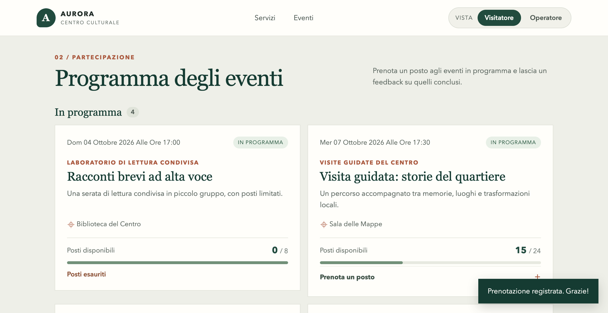
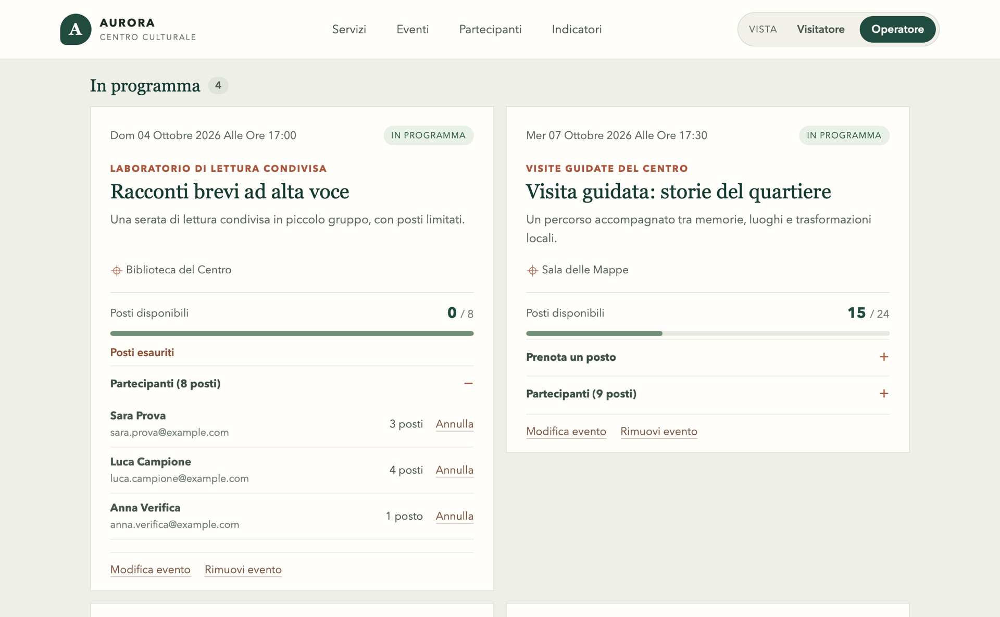
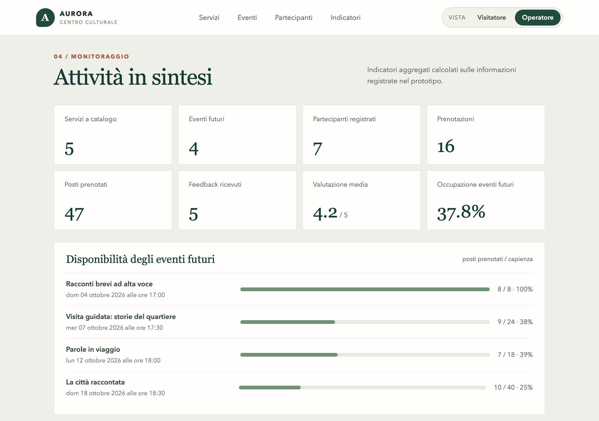

# Test funzionali e scenari d'uso

Il prototipo è stato verificato su due piani: test automatici sulle API e scenari d'uso eseguiti nel browser.

## Riepilogo

| Tipo di verifica | Quanti | Esito |
|---|---|---|
| Test automatici sulle API | 13 | 13 superati |
| Scenari d'uso nel browser | 14 | 14 superati |
| Scenari di avvio | 2 | 1 superato su macOS, 1 non eseguito |

Verifica del 1° ottobre 2026 su macOS 26.6 con Python 3.9.6, Flask 3.1.3 e SQLite 3.51.

## Test automatici

```bash
python -m unittest discover -s tests -v
```

Ogni test crea un database temporaneo con un servizio, un evento futuro da 3 posti e un evento concluso, esegue richieste alle API e controlla codici di risposta e dati salvati. Il database dimostrativo non viene toccato.

| ID | Test nel file `tests/test_api.py` | Che cosa verifica | Esito |
|---|---|---|---|
| A1 | `test_health_home_services_and_events` | La pagina si carica; le API restituiscono servizi ed eventi | Superato |
| A2 | `test_demo_data_belongs_to_fictional_cultural_centre` | I dati dimostrativi: 5 servizi, 6 eventi, 6 partecipanti con email di fantasia, indicatori attesi | Superato |
| A3 | `test_demo_data_can_be_reset` | Il ripristino riporta i dati allo stato iniziale | Superato |
| A4 | `test_service_validation_crud_and_delete_conflict` | Servizio: dati non validi rifiutati, creazione, modifica, eliminazione; rifiuto se ha eventi | Superato |
| A5 | `test_event_create_update_delete_and_capacity_rule` | Evento: creazione, modifica, eliminazione; capienza non riducibile sotto i posti prenotati | Superato |
| A6 | `test_event_cannot_be_scheduled_for_suspended_service` | Nessun evento per un servizio sospeso | Superato |
| A7 | `test_booking_capacity_duplicate_and_participant_list` | Prenotazione entro capienza; rifiuto di duplicati, posti insufficienti e dati non validi; elenco partecipanti | Superato |
| A8 | `test_booking_is_closed_after_event` | Nessuna prenotazione per un evento concluso | Superato |
| A9 | `test_booking_cancellation_frees_seats` | L'annullamento libera i posti | Superato |
| A10 | `test_feedback_requires_completed_event_and_rejects_duplicate` | Feedback solo dopo l'evento, una volta sola, voto da 1 a 5; evento con feedback non eliminabile | Superato |
| A11 | `test_users_registry_reuses_email_and_counts_activity` | Stessa email, anche con maiuscole diverse, uguale a un solo partecipante; conteggi corretti | Superato |
| A12 | `test_dashboard_aggregates_current_data` | Gli indicatori riflettono i dati inseriti | Superato |
| A13 | `test_invalid_json_and_missing_resources_return_api_errors` | Richieste malformate e risorse inesistenti producono errori JSON | Superato |

## Scenari d'uso

Gli scenari partono dai dati dimostrativi appena ripristinati.

### Vista Visitatore

| ID | Passi | Risultato atteso | Esito |
|---|---|---|---|
| S1 | Aprire la pagina e scorrere *Servizi culturali* e *Programma degli eventi* | 4 servizi attivi; 4 eventi *In programma* e 2 *Conclusi*; nessuno strumento di gestione visibile | Superato |
| S2 | *Racconti brevi ad alta voce* → **Prenota un posto** → nome ed email, 1 posto → **Conferma** | Avviso «Prenotazione registrata»; l'evento mostra «Posti esauriti» e 0 / 8 | Superato |
| S3 | *Visita guidata: storie del quartiere* → prenotare con `giulia.demo@example.com` | Avviso «Esiste già una prenotazione per questa email e questo evento»; posti invariati | Superato |
| S4 | *Laboratorio creativo in famiglia*, concluso → **Condividi un feedback** → voto e commento → **Invia** → aprire **Feedback ricevuti** | Avviso «Feedback ricevuto»; il commento compare in elenco; i feedback passano da 3 a 4 e la media si aggiorna | Superato |

Scenario S1, prima della prenotazione: l'evento ha un posto disponibile su otto.


Scenario S2, dopo la prenotazione: avviso di conferma e posti esauriti.



### Vista Operatore

| ID | Passi | Risultato atteso | Esito |
|---|---|---|---|
| S5 | Selezionare **Operatore** in alto a destra | Compare la fascia «Vista operatore»; il catalogo mostra anche il servizio *Sospeso*; compaiono i comandi di gestione e le sezioni *Partecipanti* e *Indicatori* | Superato |
| S6 | **Gestione del catalogo** → compilare tutti i campi → **Aggiungi al catalogo** | Avviso «Servizio aggiunto al catalogo»; la nuova scheda compare | Superato |
| S7 | Su un servizio: **Modifica** → cambiare i destinatari → **Salva modifiche** | Il modulo si riempie con i dati attuali; dopo il salvataggio la scheda mostra il nuovo valore | Superato |
| S8 | **Gestione del programma** → scegliere il servizio, compilare → **Pubblica evento** | Il servizio sospeso non è selezionabile; avviso «Evento pubblicato nel programma»; il nuovo evento compare tra quelli in programma | Superato |
| S9 | *Parole in viaggio* → **Modifica evento** → capienza 3 → **Salva**; poi capienza 20 → **Salva** | Primo tentativo rifiutato: «La capienza non può essere inferiore ai posti già prenotati»; secondo accettato | Superato |
| S10 | *Racconti brevi ad alta voce* → **Partecipanti** → **Annulla** su una prenotazione | Elenco con nome, email e posti; dopo l'annullamento i posti tornano disponibili | Superato |
| S11 | **Rimuovi** su un servizio con eventi; **Rimuovi evento** su un evento con prenotazioni; poi rimuovere l'evento e il servizio creati in S6 e S8 | I primi due rifiutati con messaggio; gli ultimi due accettati | Superato |
| S12 | Scorrere *Anagrafica dei partecipanti* e *Attività in sintesi* | Una riga per persona con prenotazioni, posti e feedback; 8 indicatori e barre di occupazione coerenti con i dati | Superato |

Scenario S10: l'elenco dei partecipanti comprende la prenotazione dello scenario S2.



Scenario S12: gli indicatori tengono conto della prenotazione dello scenario S2, con 16 prenotazioni, 47 posti e un'occupazione degli eventi futuri del 37,8%, cioè 34 posti su 90.



### Adattamento allo schermo e collegamento

| ID | Passi | Risultato atteso | Esito |
|---|---|---|---|
| S13 | Restringere la finestra del browser fino alla larghezza di un telefono | Menu e contenuti si dispongono su una colonna; nessuno scorrimento orizzontale | Superato a 375 pixel |
| S14 | Con la pagina aperta, chiudere il programma di avvio e premere un pulsante; poi riavviare | Compare la fascia rossa «Il prototipo è spento» con le istruzioni; al riavvio la fascia sparisce entro pochi secondi e i pulsanti tornano a funzionare | Superato, simulando l'interruzione del collegamento |

### Avvio

| ID | Passi | Risultato atteso | Esito |
|---|---|---|---|
| S15 | Doppio clic su `Avvia Aurora` | Si apre la finestra di testo e poi il browser sulla pagina del prototipo | Superato su macOS. Non provato su Windows |
| S16 | Doppio clic su `Ripristina dati demo`, risposta `s` | I dati tornano a 5 servizi, 6 eventi, 15 prenotazioni, 5 feedback | Non eseguito con il doppio clic |

Il ripristino dello scenario S16 è comunque coperto dal test automatico A3 e dall'avvio con l'opzione `--reset-demo`.

## Valori di riferimento dei dati dimostrativi

Dopo il ripristino, la sezione *Attività in sintesi* mostra:

| Indicatore | Valore |
|---|---|
| Servizi a catalogo | 5 |
| Eventi futuri | 4 |
| Partecipanti registrati | 6 |
| Prenotazioni | 15 |
| Posti prenotati | 46 |
| Feedback ricevuti | 5 |
| Valutazione media | 4,2 / 5 |
| Occupazione eventi futuri | 36,7% |

L'occupazione si verifica così: gli eventi futuri hanno capienza 8 + 24 + 18 + 40 = 90 e posti prenotati 7 + 9 + 7 + 10 = 33; 33 ÷ 90 = 36,7%.

## Casi non coperti

- Due prenotazioni realmente contemporanee sull'ultimo posto: la protezione è nella transazione, ma nessun test lancia due richieste in parallelo.
- Browser diversi: la verifica manuale è avvenuta su un solo browser.
- Carico: nessuna prova con molti utenti.
- Accessibilità: nessuna verifica con lettori di schermo.
